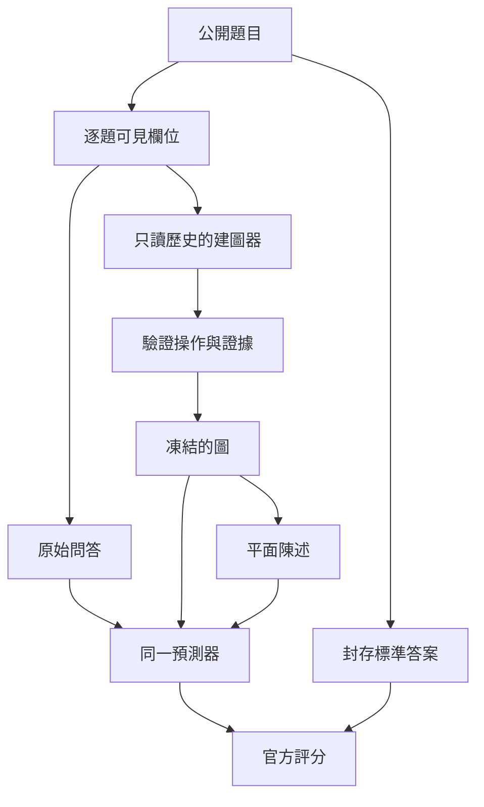

# 同一個人的訪談，畫成圖會更好預測嗎？

**llme × HugAgent｜54 位真人實驗設計｜2026-11-20**

**第一個實驗**沿用 HugAgent 的兩道原始任務。對每一道題，給同一個預測模型完全相同的個人背景和問題，改變它看到訪談的方式。一組讀全部允許的逐字問答，一組讀由這些問答抽出的證據圖。加一組讀同一張圖轉成的平面陳述，才分得出整理訪談的效果和顯式連線的效果。

W7 提出的個人比較、條件、證據指標、局部例外和可追溯更新是 **Human-origin**。W8 將 HugAgent 排在第一個實驗，也把「人在另一個情境回答不同」和「本人長期改變」拆開。以下的三組對照、兩種 Tree 關係、工具合約和網站布局屬於 **AI-origin 的候選實驗設計**。本次已查核資料並重算兩個免模型基準，尚待本機執行 raw、flat、graph 的模型比較。

## 1　先看手上到底有什麼

我從作者的 GitHub 讀取 `data-v1.1` 六個 JSONL 的完整內容，包括每題的問答清單。標籤對應 commit `5388570854cdb630a725c672bd1ccc8de0634728`。Hugging Face 提供同一釋出的 Parquet。這次選擇固定的 GitHub 原檔，有助於重現。v1.1 修正了 54 筆都市分區理由題的理由代碼與評分。下表是實際逐列統計。[資料與版本](https://github.com/jajamoa/HugAgent/tree/data-v1.1/Benchmark/data) · [修正紀錄](https://github.com/jajamoa/HugAgent/blob/data-v1.1/CHANGELOG.md)

| 主題 | T1 因果方向 | 有 T1 的人 | T2 基準立場 | T2 情境立場 | T2 理由強度 | 全部題數 |
|---|---:|---:|---:|---:|---:|---:|
| 醫療 healthcare | 108 | 43 | 28 | 130 | 314 | 580 |
| 公共監控 surveillance | 122 | 47 | 23 | 139 | 202 | 486 |
| 都市分區 zoning | 126 | 51 | 26 | 43 | 481 | 676 |
| **合計** | **356** | **54 人至少一題** | **77** | **312** | **997** | **1,742** |

- **同一批 54 人橫跨三域。** 每個「人 × 主題」都有 T2，共 162 組。有 38 人在三域都同時有 T1 和 T2。保留所有 54 人及所有可用題目，缺哪一種題就在報表呈現其分母。
- 1,742 個 item ID 均唯一，全部為 English、`test`，`context_length` 皆為 `long`。每題有 16–44 組 QA，中位數 21。每人 8–58 題，中位數 30。十道來自同一人的題目不能視作十位獨立受試者。
- T1 全部是 `A = POSITIVE effect`、`B = NEGATIVE effect`。三筆 gold 是 `A/B`，官方允許任一字母。T2 的立場題全為 1–10，理由題全為 1–5。後者佔 T2 的 71.9%。`question_number` 是訪談中的題序，無法告訴我們這個人經過幾天或幾個月後改變想法。

### 每一筆的格式與可見性

| 欄位 | 原檔內容 | 建圖器 | 預測器／評分器 |
|---|---|---|---|
| `item_id, participant_id, topic, split, task_type, context_length` | 題號、匿名人、領域與資料管理資訊 | 主程式用於分隔資料，領域名稱可作固定範圍標記 | 路由、統計使用。匿名人號及題號不寫入模型輸入 |
| `demographics` | 17 欄背景，以物件儲存 | 主試驗只從 QA 建圖 | 像官方一樣把同一份背景原文給每組預測器 |
| `context_qas[]` | 每筆含 `question_number, question, answer` | 只准讀本題給的問答，保留順序與回答者 | Raw 完整讀取。Graph 和 Flat 讀取由這份 QA 整理出的內容 |
| `task_question, answer_options` | T1 題幹、選項 | 不提供 | 預測 A 或 B |
| `task_question, question_type, scale, reason_text?` | T2 題幹、題型、量尺、理由措辭 | 不提供 | 依官方模板出整數。理由題保留原文指定的理由 |
| `question_id, reason_code?` | 問卷題號及理由代碼 | 不提供 | 主程式配對、切片。reason code 不另塞給模型 |
| T1 `answer, source_qa, reasoning`；T2 `user_answer` | 真人答案、被遮住的原 QA、標註解釋 | 只在獨立稽核／評分程序讀 | 推論結束後才與輸出 join |

GitHub JSONL 的內嵌物件和清單可直接解析。HF Parquet 中 `demographics, context_qas, answer_options, source_qa, scale` 以 JSON 字串儲存，應逐欄解碼一次。作者沒有放出每位受訪者的完整逐字稿、聊天紀錄與整份原始問卷。本文的 **Raw** 指該題官方允許的全量訪談摘錄。[資料卡與欄位](https://github.com/jajamoa/HugAgent/blob/data-v1.1/hf/README.md) · [公開範圍](https://github.com/jajamoa/HugAgent/blob/data-v1.1/DATA_RELEASE.md)

### 六筆實際抽樣

為了能重抽，先按 task × domain 分六組。T2 的醫療、監控、分區分別選基準立場、情境立場、理由評分，再於各組按完整 item ID 字典序取下中位數。此抽樣刻意涵蓋格式，不用來估計答題難度。以下為題意中文轉述，正式實驗保留英文。最後一欄只供人核對。

| 原檔／ID 尾碼 | 人 | QA 數 | 題目到底在問什麼 | 作答格式／gold |
|---|---|---:|---|---|
| T1 healthcare-0054 | P48 | 21 | 這人認為，控制成本會提升還是降低對全民醫療的支持？ | A/B；A |
| T1 surveillance-0061 | P17 | 21 | 他認為，監督監控技術的使用，會怎樣影響對監視器的支持？ | A/B；A |
| T1 zoning-0063 | P53 | 26 | 他認為，住房的可負擔性會怎樣影響增建住宅的支持度？ | A/B；A |
| T2 healthcare-0236 | P08 | 23 | 他對美國實施全民醫療的基準支持度？（3.1） | 1–10；10 |
| T2 surveillance-0163 | P17 | 22 | 若攝影機交給地方社區委員會管理，他會給幾分？（2.8） | 1–10；9 |
| T2 zoning-0275 | P50 | 27 | 「人人應分擔開發責任」對他的立場有多少影響？（1.1r_G） | 1–5；2 |

完整 ID 前綴分別為 `belief_state_inference-` 與 `belief_dynamics_update-`。這六筆已經看過答案，可作資料文件，別拿去當模型的 few-shot 或拿來挑 prompt。若事後根據真人錯題修改方法，另標 exploratory，或預先保留以人為單位的未碰子集並揭露樣本數。

## 2　為什麼主實驗要按「可見證據」建圖

**把同一人同一主題的 QA 全合起來，會直接洩漏 271/356 道 T1 的保留問答（76.1%）。** 我逐題比對 `source_qa` 的完整 question 與 answer。該 QA 在本題允許的 context 中命中 0 次，但在同一人同主題的 T2 context 中，醫療命中 89 道、監控 100 道、分區 82 道。這是字面完全相等的檢查，不能排除改寫或共同線索。

W7 的 P07 可以直接說明。監控 T1-0009 有 19 段 QA，要推論「執法問責」對支持監視器的影響。P07 的監控 T2-0015 有 20 段 QA，其中第 11 段正是前題被遮住的問答。若先把 20 段交給模型寫摘要，即使之後刪掉第 11 段的原文，摘要也可能已寫入答案。

**可重用的單位**是同一人、同一來源域、同一份依序排列的允許 QA。依這個定義，全資料只有 **460 份不同的證據範圍**。T1 有 319 份，T2 有 162 份，兩邊有 21 份相同。每人每域的 T2 共用同一份 context。落地時另把資料版本、模式、builder 版本及設定帶入快取鍵。研究介面仍能選擇全部 54 位匿名參與者，點進一道題才載入該題允許的版本。

## 3　第一輪的三個比較條件

| 條件 | 預測模型看到什麼 | 這個差值可回答什麼 |
|---|---|---|
| **Raw** | 官方 `build_prompt` 的完整背景、所有允許 QA、原題及選項／量尺 | 忠實重跑的 full-context 基線 |
| **Graph** | 相同背景和題目，中間換成凍結的節點、具方向的關係、適用條件和原話短摘 | Graph − Raw 衡量「整套建圖與讀圖」對預測的淨影響 |
| **Flat** | 用確定性模板把**同一份**抽取結果攤成獨立句子。每句保留主體、方向、條件、強弱用語和同一摘錄 | Graph − Flat 衡量顯式節點連結／圖的文字編碼帶來多少額外效果 |

Raw 與 Graph 先端到端跑通，正式主表三組都跑 1,742 題。三組預測端共 5,226 個題次。假設每份證據一次成功抽取，Graph 與 Flat 共用約 460 次建圖，合計約 5,686 次模型請求；多段工具呼叫、重試或多個 seed 會增加實際次數。Flat 不再呼叫另一個 LLM 改寫。若有餘力，再用同等 builder 預算生成自由文字摘要，可分辨是否連固定格式都不需要。

- **原始輸入與預算。** 同一模型快照、provider、system 指令、demographics、測試題、解碼設定及輸出上限。主表保留完整 Raw，選能容納最長輸入的視窗。Graph 讀完整的凍結圖，不預先加檢索或反覆叫工具。記錄每組實際 token 和成本。相同上限並不保證使用量相同，另做預先指定長度的敏感度實驗，完整揭露刪掉多少 QA／主張，不以截短的 Raw 取代主基線。
- **主指標。** 分別回答 T1 與 T2。預先指定 T1 三域等權的 BSI accuracy、T2 三域等權的標準化 MAE 為主要終點，完整輸出官方 BDU tolerance accuracy、directional accuracy 及 ATI。T2 另列基準立場、情境立場、理由權重三列，否則大量的理由題會掩蓋立場預測。若打算主張任一主指標顯著即算成功，預先處理多重比較；否則逐項報效果量與區間，不合併成單一勝負。
- **配對與誤差。** 同一題跑三組。以人為單位有放回抽 54 人，保留每人的所有題及三組成對輸出，建議 5,000 次 bootstrap，計算每個差值的 95% 區間。每次仍先算域內指標再平均。重抽到同一人時以複本身分保留其整組題目，避免 scorer 字典去重。附逐人改善／持平／退步、三域分數、未解析率與成功配對數。模型 seed 的波動與受試者抽樣的不確定性分開報。
- **真正的預測格式。** T1 只交 A 或 B。T2 依指定量尺只交整數。10 分量尺的絕對誤差除以 2 才併入官方 MAE；5 分量尺直接用絕對誤差。命中容差分別是 ±2 和 ±1。方向分數以**模型自己的基準預測**配自己的情境預測，再與真人配對比較。官方方向分數是 0.3 × 改變與否命中率，加 0.7 × 雙方都判為改變時的方向命中率。gold 與預測都有基準且可解析才列入；全量最大 179 對（醫療 83、監控 75、分區 21）。另外報簡單三類方向準確率時，明標為補充指標。
- **資料品質驗收。** 獨立評分程序餵入原版 scorer 要求的每行 `{"item_id":"…","response":"…"}`；先檢查重複、少題、範圍與解析。模型若失敗要列入分母並照官方計分，禁止只報成功題。本次以六檔的評分欄位投影，實際執行原版免 API 基準，得到下表。它們也可用來驗證本機管線。官方對 `--data-version` 的字串標記不會替你鎖住下載版本，應鎖 commit 或檔案雜湊。[作者評分程式](https://github.com/jajamoa/HugAgent/blob/data-v1.1/Benchmark/hugagent_eval.py)

| 不呼叫模型的檢查 | BSI Acc % | BDU Acc % | BDU MAE | BDU Dir % | ATI |
|---|---:|---:|---:|---:|---:|
| 一律答 A／1 | 63.64 | 56.07 | 1.73 | 15.34 | 0.76 |
| 隨機，作者預設 5 seeds 平均 | 50.51 | 44.44 | 1.81 | 47.93 | 0.12 |

**解讀結果。** Graph 勝 Raw、與 Flat 接近，支持抽取與整理有幫助，顯式連線的額外效益仍待證明。Graph 勝 Flat、但未勝 Raw，表示連線能改善壓縮後的讀法，原始訪談仍保有額外線索。若 T1 改善、T2 理由強度退步，回查圖是否把「稍微」和「非常」都變成同一個正向箭頭。若分數相近、token 較少，再以建圖成本、重用次數、可檢查性判斷工程價值。沒有足夠證據時保留零效果這個結果。

## 4　Graph 先存哪一種知識？

| 單位 | 第一版存什麼 | 一個需要分清的情況 |
|---|---|---|
| Evidence | immutable QA、發言者、原文跨度、出處、題內位置 | 回答「是」必須和它回答的問題一起看；訪談者的誘導問句本身不足以算作個人信念 |
| Concept | 本議題原文中可辨認的考量、行動或立場對象，保留別名 | 「支持監視器」與「認為其他人會支持」可以指向同一概念，但主張的持有人不同 |
| Claim | 可引用的主張物件，連回概念與一或多筆證據，帶 holder、關係、方向、scope、明說／推論 | 「他認為隱私疑慮會降低民眾支持」是一條他陳述的影響關係；不能因此填入他本人的隱私權重 |
| Scope | 領域、證據支持的條件；需要時加目標或對象。發生時間和假設條件可空 | 「只保存 48 小時」若只出現在題幹，屬本次查詢的暫時情境，不能寫回個人歷史 |

主張可表示 `influences`（主觀正／負／不明）、`stance_on`、`prefers_over`（選項比較）、`more_important_than`（屬性取捨）。原話說「非常強」就保留短語。一次選 A 只直接支持該條件下選 A，要寫「安全比收益重要」仍需本人理由或標成有依據的推論。沒有明說的數值效用留空；官方要求的 1–5、1–10 由共同預測器在作答時估計。維持 unknown、indifferent、incomparable 三種語義；允許相反主張同時存在，有環的比較留給研究者檢視。必要時用 Claim 當可引用的關係節點，將 actor、兩個屬性、條件及證據串起來，已能表達 W7 的超邊草圖。

**以 P07 的一條真實 QA 走一次。** 在監控 T1-0009 的原訪談題號 10，P07 說有隱私疑慮的人較不支持監視器，且這個影響很強。建圖可存「說話者 P07／談論對象 一般人／隱私疑慮 → 對監視器的支持／負向／原詞 strong／來源 QA 10」。若建圖器把它寫成「P07 本人一向反對監控」，引用即使存在，主體也已改錯。換到 T2-0015，48 小時保存期限來自新題的情境；預測器可以拿它讀圖，不能因此在圖上寫入「P07 接受 48 小時」。在他答完之後才揭露的真人分數，是評測這次推論的依據。

**從兩份簡報取用的範圍。** PGMem 的來源與支持關係適合第一版。State／Trait 只有在證據能支持適用期間時才細分。Persona-DB 的觀察與抽象可標在 Claim 上，先做同一個人的抽取；這 16–44 組 QA 可先全部讀取。TCP-nets 借的是兩個屬性的條件式取捨，實驗先記錄局部比較。完整 dominance solver、多層檢索、跨人 JOIN、寫入模型參數和新訪談流程都可獨立研究，對這個主對照沒有前置依賴。[PGMem](https://aclanthology.org/2026.emnlp-main.1891/) · [Persona-DB](https://aclanthology.org/2025.coling-main.20/) · [TCP-nets](https://www.cs.cmu.edu/afs/cs/project/jair/pub/volume25/brafman06a.pdf)

## 5　例外 Tree 與子情境 Tree 可以共存

**情境有上下層，規則才有例外。** 用 `subcontext_of(child_scope, parent_scope)` 表示條件集合包含，用 `exception_of(local_rule, default_rule)` 表示某一條有證據的規則在該範圍改用另一條。兩種關係共存於同一張底層圖，介面能投影成「全部子情境」或「只有發生規則差異」兩種樹。W7 提的「需要不同處理才長 child」，可以保留為**例外視圖的建枝條件**。

| 新發現 | 應如何記錄 | 是否有例外？ |
|---|---|---|
| 一般立場未知，只知道他談到「社區管理的攝影機」 | 建立／標記較窄的監控情境；保留局部證據 | 父規則未知，例外狀態待定 |
| 父層已有「通常支持」，在特定條件只補充了另一個支持理由 | 子情境補充原因，未受影響的規則可沿用 | 不產生相反的規則 |
| 本人表明「通常支持，除非可以長期辨識個人」 | 局部條件＋覆寫同一立場的父規則，各自連證據 | 可顯示為該規則的例外 |
| 同時符合「地方管理」與「長期辨識」，兩條說法衝突 | 取兩邊證據。若沒有明確優先序，保留未解並回報 | 不能用最後出現或樹深擅自裁決 |
| 本人明說以前與現在在相同條件下改觀 | 另記有時間出處的 revision／supersedes，保留舊版本 | 這回答了另一個問題，即何時改變 |

第一版的 query 可指定條件並讀圖，**先比 Graph vs Raw**。若人工稽核發現足夠「父規則已知＋條件可辨＋局部結果不同」案例，才開 Tree ablation：同一批凍結規則、相同證據和預算，比平面規則匹配與樹的繼承／覆寫；報可用案例數、涵蓋率及配對結果。若只看到相同條件與結論，兩種等價的索引本應給出相同結果，可改比 token、延遲、可追溯性。沒有額外標註時，原任務分數不能驗證樹長得正不正確。時間順序、資料鮮度與真人偏好版本各用不同欄位，單次問卷不足以估計長期漂移。

## 6　系統邊界與 LLM 工具操作

**三個介面就能支持主試驗。** Dataset adapter 將資料分成允許歷史、預測問題、封存 gold。建圖 LLM 輸入題內歷史及型別定義，只產生有證據的結構化操作。預測 LLM 輸入背景、指定表示、原題與輸出格式。第一版讀圖採固定序列化，避免 Graph 組比 Raw 多次思考；多步工具檢索可另開一組。builder 與 predictor 可以先用同一快照、分開角色與上下文，未來可單獨替換。provider 設定、model ID、prompt/schema 版、temperature、seed 支援狀態、context limit、輸入輸出 token 與時間由 host 保存。

| 操作 | 呼叫者與輸入 | 結果與檢查 |
|---|---|---|
| `evidence_read` | 建圖器，傳本 scope 的 evidence IDs；小範圍時 host 可直接提供全部 QA | 回帶原文、題內位置、可引用的 Q 與 A。scope 在 host 綁定 |
| `graph_propose` | 建圖器，傳 `request_id, expected_revision, operations[]`。批次內可使用暫時 ID | host 驗證型別、端點、證據引文、來源範圍與原子性；成功回草案或結構化錯誤 |
| `graph_commit` | 只有 host 對已驗證草案提交 | 回新 revision、穩定 ID 與事件序號。重試冪等、舊版衝突有明確結果，失敗不留下半張圖 |
| `graph_read` | 預測 runner／研究者，指定凍結版本和視圖 | 回 node／claim／evidence references 或固定的完整表示。額外鄰域查詢列入工具消融 |
| `trace_read` | 評測後的研究介面，依 run、scope、revision 查 | 取得提議、拒絕、修正、提交和預測事件。評分資訊只在結果頁 join |

可先採 in-process tool registry，保留 MCP 風格的 `tools/list`、`tools/call`、JSON Schema、結構化成功／錯誤。接遠端 MCP server 是後續部署選擇。工具呼叫紀錄由應用自行寫入；MCP 本身不會替研究者提供可重播的交易歷史。每次事件記 `run_id, scope_id, request_id, revision_before/after, event_seq, actor, op, args_ref, result/error, evidence_refs, model_config_hash, elapsed_ms, token_usage`。保存必要的結構化理由與可引用原文；模型內部思考不屬於稽核資料。重播已提交操作必須能在不呼叫 LLM 的情況下產生相同 snapshot hash。[MCP 工具規格](https://modelcontextprotocol.io/specification/2025-11-25/server/tools)

**驗證把關的邊界。** 引文須能對回原字串、方向和端點須合法、同一個 request 的 retry 不重複加節點。這只能證明格式與來源存在。「引文是否真的支持主張」「他是在談自己還是一般大眾」需要語義抽查。格式修復重試要有上限；建圖失敗保留狀態，缺圖率、模型請求數和成本一起報。另記 session／artifact 的操作版本，切勿從事件序號生成受訪者的時間線。

W7 的更新動詞可以直接映到同一份事件紀錄。第一次讀到一條主張用 `add_claim`，再讀到支持它的另一筆原話用 `attach_evidence`，有反證用 `challenge_claim`。若原話說「剛才我看錯題目」，用 `retract_claim` 留下更正理由和舊版。若本人明述同條件下的持續改變，才提議 `supersede_rule`。依賴撤回證據的推論標為待重查，有其他獨立支持的主張保留。前兩個操作足以從靜態歷史建出第一版。後三個操作可以先用合成案例驗收，不把它們的成功率宣稱為 HugAgent 的真人結果。

## 7　圖的檢視網站應能回答什麼？

網站首先是實驗的**逐題除錯器**。第一個畫面能看到 54 人涵蓋率、域別、任務、Raw／Flat／Graph 分歧、未解析及成本。點一題，在十幾秒內就應能追出「哪句話被怎麼理解」。真人資料只在本機研究檢視該題的允許證據。對外展示布局與操作用自造案例；作者的資料用途限定非商業的個體推理評估，明列禁止建置針對個人的側寫、說服、鎖定系統及再識別。[資料使用範圍](https://github.com/jajamoa/HugAgent/blob/data-v1.1/Benchmark/data/LICENSE)

| 畫面 | 布局與互動 | 驗收情境 |
|---|---|---|
| 實驗總覽 | 上方選 run／模型／資料版；主區並列三組與每域分母，下方列題目。可篩「Raw 對、Graph 錯」及相反情形 | 從 BDU 理由題分歧一鍵打開對照，回上一頁保留篩選 |
| 逐題證據 | 左欄約 30% 顯示依原序的 QA，中欄約 45% 顯示圖，右欄約 25% 顯示題目、預測與選中主張。Raw／Flat／Graph 可切換實際送入模型的文字 | 點 claim，同時高亮引用的 Q/A 字段並標出 holder 及條件；揭露 gold 前可做盲判 |
| 圖與分支 | 預設只展開該題附近的概念與主張，原始 evidence 點選後展開。箭頭和文字標明因果方向或比較；虛線顯示來源。層次布局、固定 ID 與座標，切換版本只增減局部 | 不靠紅綠色辨認正負；條件標成「題目假設」或「本人證據」；無例外時顯示「父規則缺證」等實際狀態 |
| 操作與版本 | 底部時間軸顯示 propose、reject、commit、predict。點事件看 before／after、失敗原因與 evidence ID，並能鎖住同一圖位置看 diff | 用合成 fixture 示範重試未重複加邊，重播回相同圖；評分出現後，重算同一個預測 payload 應完全相同 |

桌面三欄，窄螢幕改「題目／圖／證據」頁籤並保留選取。讀一段話時不讓力導向布局持續移動。若 repo 尚無圖元件，可比較 Cytoscape.js 與既有前端整合，ELK Layered 可做穩定的初始層次布局。先完成一題的讀圖與 provenance，再擴展 run 總覽。[Cytoscape.js](https://js.cytoscape.org/) · [ELK Layered](https://eclipse.dev/elk/reference/algorithms/org-eclipse-elk-layered.html)

## 8　三個主題如何做真正的跨情境驗證

原文已做同一人跨域 swap，包含醫療 → 監控、監控 → 分區、分區 → 醫療。論文 GPT-4o 的 BDU 平均正確率由域內 63.11% 降至單來源跨域 44.64%。這是論文歷史設定的結果。這項延伸可以直接問「同樣換掉來源域，圖比 raw 少掉幾分？」[HugAgent Table 3](https://arxiv.org/html/2510.15144v3#S5)

| 設定 | 同一個人提供哪些證據 | 能回答的問題 |
|---|---|---|
| 域內主試驗 | 目標 item 自己的白名單 | 個體訪談圖能否改善官方兩任務 |
| 原論文三方向 | 僅用指定**來源域**訪談，目標域只給題目＋原作允許的個人背景 | 同樣缺少目標域史料時，結構化是否比 Raw／Flat 多保留可轉移線索 |
| 兩域推第三域 | 用同人另外兩域，依序輪替三個目標域；增加要求相近 token 預算的單域對照 | 第二個來源域有額外訊息，或只是輸入變長 |
| 同域不同假設 | 只用官方 item 的歷史，按不同 intervention 切片比較；同人有基準才計方向 | 能否使用這一題提供的局部條件。這和真實跨時改變需要不同證據 |

每個來源域可直接選定同人同域的唯一 T2 訪談範圍，取 QA 欄即止。三個方向一共仍是 1,742 個目標題，每題出現一次。測同一目標時 Raw、Flat、Graph 使用相同來源與證據。預先凍結何者是一域來源、如何排列兩域及如何截斷；目標域 QA、答案、由它們產生的別名或抽象規則都不進入來源圖。維持官方 demographics 時須註明其中本來就有健康保險、住宅等跨域背景；想測純訪談轉移可另做各組都移除背景的敏感度實驗。此次逐字比對，356 道 T1 的保留 QA 在**本人另外兩域**的標準 T2 證據中命中 0 次；這不保證完全沒有語意提示。此處「三個」按 HugAgent 的三個真人主題解讀。CUPID 的 Consistent／Contrastive／Changing 可留給另一次合成對照。

## 9　哪些構想值得等到下一步

### 最貼近 W7 的衍生任務現在就能做

**哪一個理由對這個人影響較大？** 從已發布的 997 道理由題，按「同一人、同一域、同一 survey question stem」分組（如 `3.7r_G` 與 `3.7r_H` 同屬 `3.7`）。每組取不同理由的所有無序配對，以兩個真人 1–5 評分產生「甲較高／同分／乙較高」。這是問卷理由強度的相對次序。真正的屬性取捨還需要讓兩項利益在可行選項中衝突，觀察本人願意犧牲哪一項。

|  | 至少兩理由的人×情境組 | 理由配對 | 真人同分 | 真人有高低 |
|---|---:|---:|---:|---:|
| 醫療 | 81 | 245 | 137 | 108 |
| 監控 | 59 | 149 | 89 | 60 |
| 分區 | 122 | 600 | 361 | 239 |
| **合計** | **262 組／52 人** | **994** | **587** | **407** |

不增加模型呼叫就能先評。用 Raw、Flat、Graph 已交的兩個預測分數取符號，報三類正確率和 407 對真人有高低時的嚴格方向正確率（模型答同分算錯）。一律猜同分已有 59.1% 整體正確率，要一併列出。再報逐人或逐情境平均，避免理由多的情境因為配對數多而主宰結果。若有單獨的 pairwise prompt，回答改為「甲／乙／同等影響」，以交換甲乙順序測位置偏差，另列為新增任務。這些 gold 配對只進 scorer。

**這也說明了 Tree 的資料限制。** 再嚴格要求同一人、同一域、兩個理由的完整英文措辭逐字相同，且在另一個問卷情境也有兩個分數，只剩 11 人的 19 組跨情境比較（醫療 14、監控 5）。其中 6 組在同分與分出高低間移動，13 組次序符號相同，0 組出現嚴格反轉。不同措辭但語義相近的理由尚未經人工對齊。這 19 組不足以宣稱人沒有例外，卻足以提醒我們，用現成評分驗證「兩理由優先序翻轉」時，幾乎沒有可用的正例。

### 後續需要人工標註或受控資料的測試

| 候選延伸 | 需要什麼資料或標註 | 可評什麼 |
|---|---|---|
| 圖忠實度 | 從三域按人抽 claim、刻意包含 inferred／否定／泛指。兩位盲於作答結果的讀者判斷引文是否支持、方向與主體是否正確 | 支持率、分歧率、標註一致性。固定人工標註後，才有依據報 evidence Recall@K |
| 情境例外路由 | 人工先標有明確父規則和子條件的真實案例。若數量少，報適用率；另以自造或 CUPID Contrastive 做有標籤對照 | matched subset 上 flat rules vs tree 選對規則的比例、預測差異、成本 |
| 個人偏好變更／撤回 | 可排序的跨次互動、有時間依據的自述或受控合成事件。真實日期與 session ID 作獨立欄位 | 舊規則是否仍被誤用、該撤回的主張有沒有撤回、有無破壞無關規則 |
| 圖的依賴與穩健性 | 合成題可事先指定唯一證據，只改一個條件／遮住關鍵句／翻轉主張。真人可做人審遮蔽前後預測敏感度 | 語義該翻時翻、不該變時穩定。模型合成答案屬控制題，不當真人信念 gold |

通用的部分維持在 Evidence、Claim、Scope、來源以及查詢／評分的介面。HugAgent adapter 宣告「有假設情境、可做同人跨域、未提供完整縱向版本標籤」。下個 dataset 自行宣告時序、選擇、比較與標註的可用性。先保證一個真人 benchmark 的讀取和計分正確，再由第二個資料來源決定哪些欄位確實通用。

**最有力的反例。** 若 Flat 已經同樣好，你可能只需要把訪談整理乾淨。Deng、Ye、Candogan 已在 Twin-2K-500 的產品訂價題上比較完整調查歷史與任務專屬的精簡表示，後者在兩波資料均有提升。因此「結構化可能勝過全文」已有先例，這裡值得測的是有來源的關係對個體信念方向、理由強度與跨域轉移各帶來什麼。Fatemi 等人也觀察到，同一張圖用不同文字編碼會影響 LLM 的圖推理表現；本設計才固定 renderer 並保留 Flat 組。[Deng et al., v2](https://arxiv.org/abs/2608.20344v2) · [Talk Like a Graph](https://research.google/pubs/talk-like-a-graph-encoding-graphs-for-large-language-models/)

## 10　本機執行順序與待討論的選擇

1. **對齊規格。** 先核對六檔、scope 數、遮蔽和免模型分數。用自造 QA 或去重的獨立 synthetic 開發 schema／prompt，完成三組 payload 的人工檢查。
2. **凍結後比較。** 在一份 manifest 固定資料、模型、prompt、renderer、主要終點與分析方法；對 54 人跑全量三組。研究預設選一個有固定版本、可使用的 backbone。若本機資源只允許兩組，先得 Raw–Graph 的系統差值，待補 Flat 後再主張圖結構本身的效果。
3. **讀分歧。** 用逐題圖回看「取錯主體」「丟掉強度」「條件被過度泛化」「引文不存在」「有證據仍預測錯」「本題資料不足」。讀過真人錯題後的新設計另行版本化；原封存結果作第一次比較的紀錄。
4. **第二輪才做三域 swap 或 Tree。** 想查跨域就複用原文三方向。想查例外就先回報可辨認父子規則的案例數。若多數題只有當下證據，保留情境標籤即可。

值得和老師討論的選擇只有兩個。第一，如果 Graph 預測相近卻能大幅降低 token、解釋每一筆誤判，你是否也視為研究上有價值？第二，跨域時你希望證明「能搬用原本同一條規則」，還是接受「只要有人的其他領域證據，就能更準」？前者需要人審規則是否跨域成立，後者可以直接以真人題目的配對分數驗證。

**研究脈絡**　[W7 個人圖與比較、例外及證據](https://docs.google.com/presentation/d/1aXcTNnpU6irPR4whTkEtfZpuolT8YGqpj9jwj5mFjr0/edit) · [W8 情境、圖與第一個實驗](https://docs.google.com/presentation/d/1bg_3PSv4JxVrcm4fCYu3QbE8ulXf7ARmnJQ-I2ijnn4/edit) · [HugAgent 正式論文](https://aclanthology.org/2026.emnlp-main.706/)
