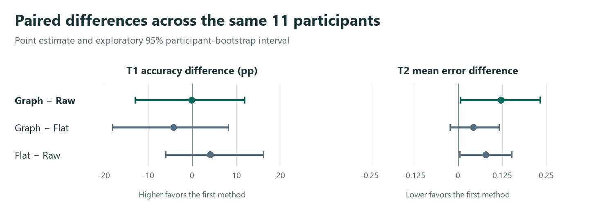

# 第一次實驗｜把訪談整理成 Graph，能更準確預測本人的答案嗎？

**2026-11-24 · HugAgent · P01–P10、P44 · 11 人、380 題**

這批資料裡，Graph 沒有提高整體預測表現。**在 67 道因果方向選擇題上，Graph 與直接讀訪談的 Raw 幾乎持平。在 313 道量表題上，Raw 的答案最接近本人，且三個領域都呈現相同方向。** 將相同主張改寫為平鋪文字的 Flat，在三個模型模式中選擇題得分最高；同批題目的固定選 A 基準仍然更高。

## 研究背景與比較設計

研究關心的是模型能否從一個人的訪談中，讀出他認為哪些因素有影響、在什麼條件下成立，以及影響有多強。圖可以把主張和證據連在一起，方便查核；整理訪談時，也可能遺漏影響作答的細節。因此第一次實驗先固定預測模型和題目，只改模型讀到的訪談表示，觀察這個改動對預測的影響。

| 模式 | 預測模型讀到什麼 | 能回答的問題 |
|---|---|---|
| Raw | 該題允許使用的完整訪談問答 | 直接讀原話時，模型能預測多準？ |
| Graph | 從同一份訪談抽出的概念節點、有方向的關係、條件與證據，以文字序列送入模型 | 經過抽取和建圖後，預測與 Raw 差多少？ |
| Flat | 把 Graph 的同一批主張、條件與引文逐條寫成句子 | 保持抽取內容相同時，圖的表示方式是否有額外收益？ |

三組都使用 `gemini-3.5-flash-lite`。每題只取該題允許的訪談問答，可見內容完全相同的題目才共用建圖結果。這點很重要，因為同一位受訪者在另一題可見的原話，有時已經透露這一題要預測的答案。標準答案在離線評分時才加入。[實驗接口](../experiment-interfaces.md) · [資料與可見範圍](../prepared-data.md)

## 樣本與評分

這是 54 人、1,742 題資料庫中的首批已完成實驗。11 人共有 **94 份不同的可見訪談**，每份可供一題或多題共用。380 題各有三個作答格，共 1,140 格。P01 採續跑完成的 `P01-resumed`，P07 採補跑完成的 `p07-recovered`，每題只計一次。

| 任務 | 醫療 | 公共監控 | 都市分區 | 判分方式 |
|---|---:|---:|---:|---|
| T1 因果方向 | 17 | 22 | 28 | 共 67 題。選項符合官方可接受答案時計為正確，缺答計錯。 |
| T2 量表預測 | 93 | 86 | 134 | 共 313 題。計算預測與本人量表答案的絕對差；10 分量表誤差除以 2，5 分量表保留原值。另計容許命中率，兩種量表分別容許相差 2 分及 1 分。 |

官方總分先在各領域內計算，再將三域等權平均。因此可以用原始題數理解改變了幾題，用官方總分比較三個領域的整體表現。下表的固定答案基準也在**相同的 380 題**重算。[評分與分析設計](../analysis-plan.md)

## 主要結果

| 方法 | T1 正確率 ↑ | T2 平均絕對誤差 ↓ | T2 容許命中率 ↑ | T2 方向分數 ↑ | 綜合指標 ATI ↑ |
|---|---:|---:|---:|---:|---:|
| 固定選 A／固定填 1 | 68.04% | 1.675 | 58.55% | 14.78% | 7.67 |
| Raw | 55.37% | **1.393** | 55.79% | **83.08%** | 38.67 |
| Graph | 55.27% | 1.514 | 50.12% | 78.92% | 32.50 |
| Flat | 59.52% | 1.471 | 52.40% | 79.75% | **39.99** |

固定選 A 就能得到 68.04%，可見這批 T1 題的選項分布足以影響正確率。T2 的幾個指標也回答不同問題。固定填 1 有最高的容許命中率，但平均誤差最大；Raw 的平均誤差最小，追蹤同人立場變化的方向分數也最高。ATI 是官方綜合指標，單位與正確率不同。

### 同一題換了表示，究竟改變多少？

| Graph 與 Raw 的逐題配對 | 都命中 | 僅 Graph 命中 | 僅 Raw 命中 | 都失分 |
|---|---:|---:|---:|---:|
| T1 選項正確，67 題 | 30 | 9 | 10 | 18 |
| T2 落在容許範圍，313 題 | 154 | 10 | 26 | 123 |

T1 整體近乎持平，背後其實有 **19 題**改變對錯。T2 則有 **26 題**僅 Raw 命中，**10 題**僅 Graph 命中。單看容許門檻仍會漏掉一種情況：兩個回答都在門檻內，其中一個更接近本人。因此主要比較採用下表的 T2 平均絕對誤差。

| 同題配對（前者減後者） | T1 正確率差，百分點［95% 區間］ | T2 平均誤差差，分［95% 區間］ |
|---|---:|---:|
| Graph − Raw | −0.10 ［−12.96, +11.87］ | +0.122 ［+0.008, +0.232］ |
| Graph − Flat | −4.25 ［−17.99, +8.17］ | +0.044 ［−0.023, +0.116］ |
| Flat − Raw | +4.15 ［−5.99, +16.11］ | +0.078 ［+0.006, +0.152］ |

以**受訪者**為單位配對重抽 5,000 次，同一人的題目和三組答案一起保留，沿用三域等權，取百分位區間。T1 的區間容許兩個方向的差異，這批樣本還不足以判定哪種表示穩定領先。T2 中 Graph 和 Flat 的誤差都高於 Raw；直接比較 Graph 與 Flat 時，區間跨零。這使「整理訪談時丟失了與量表強度有關的線索」成為值得檢查的解釋，單靠這三組分數仍無法確認原因。

### T2 的差距出現在哪裡？

| 領域 | 題數 | Raw 誤差 | Graph 誤差 | Flat 誤差 |
|---|---:|---:|---:|---:|
| 醫療 | 93 | 1.538 | 1.602 | 1.613 |
| 公共監控 | 86 | 1.517 | 1.669 | 1.628 |
| 都市分區 | 134 | 1.123 | 1.272 | 1.172 |

| 題型 | 題數 | Raw 誤差 | Graph 誤差 | Flat 誤差 |
|---|---:|---:|---:|---:|
| 基準立場 | 23 | 0.587 | 0.674 | 0.696 |
| 經驗或感受 | 35 | 1.643 | 1.671 | 1.686 |
| 假設情境 | 34 | 1.029 | 1.059 | 1.147 |
| 理由的影響強度 | 221 | 1.439 | 1.597 | 1.507 |

題型表在每一類內按題平均。理由強度占 221／313 題，也是四類中 Graph 與 Raw 誤差差距最大的一類。若要釐清原因，可優先檢查該類失分題的原話、被抽出的主張與進入模型的提示詞，看強弱語句是否保留，以及保留之後模型是否仍然選錯分數。

## 建圖品質、截斷與解讀限制

- **實際建成的圖。** 94 份訪談中，39 份直接通過、2 份經格式修復、47 份採用通過驗證的部分主張。另有 6 份只保留問答證據，供 17 題使用。共保留 1,672 條有引文的主張，其中 323 條記有條件；6 份備援資料另外產生 133 條證據關係。引文核對能確認來源，至於主張是否保留原意與強度，仍需逐題判讀。
- **Tree 的證據範圍。** 本輪有 0 筆明示覆寫。互動頁依已存條件整理成樹，方便檢查哪些主張在特定條件下成立。模型實際比較的三種輸入為 Raw、Graph、Flat；Tree 路由的預測效果仍待獨立實驗。
- **缺答對結果的影響。** 10 格輸出達長度上限，全部發生在 T1，分別是 Raw 6、Graph 1、Flat 3。官方主分析完整保留 67 題。只看三組都成功解析的 58 題時，三域等權正確率依次為 59.94%、59.39%、66.51%；這個篩選會改變題目組成。T2 的 939 格全部有可解析答案，其誤差差距不受此次截斷影響。
- **推論範圍。** 這次觀察來自 11 位受訪者與一個模型。重抽區間描述這批受訪者之間的變異，並未涵蓋模型重跑的變異。建圖修復、證據備援與抽取內容的差異也都計入了實際流程的表現。

## 資料來源與核對方式

原始資料與官方評分器來自 HugAgent Authors 的固定版本。此處提供同批資料的彙總分數、衍生統計與配對圖。[HugAgent 固定版本與來源指紋](../../../tools/hugagent/source.json) · [上游資料授權](https://github.com/egger-meow/HugAgent/blob/2bbd18e76db4be1de3b5bce3b5e239898a6a2750/Benchmark/data/LICENSE) · [本報告完整彙總數值（JSON）](results.json)

具有原始資料與保存 run 的本機可在 repo 根目錄執行 `python -m llme.cohort`，再用瀏覽器開啟 `ref/experiments/cohort/index.html`。產生器會核對各 run 的作答、建圖快照與官方分數，然後重算合併結果。現場展示時，從「Graph 與 Raw 在哪些題目互有得失？」點題數，可看到題幹、本人答案和三組回答，再沿箭頭查訪談引文。[報告產生程式](../../../llme/cohort.py)
