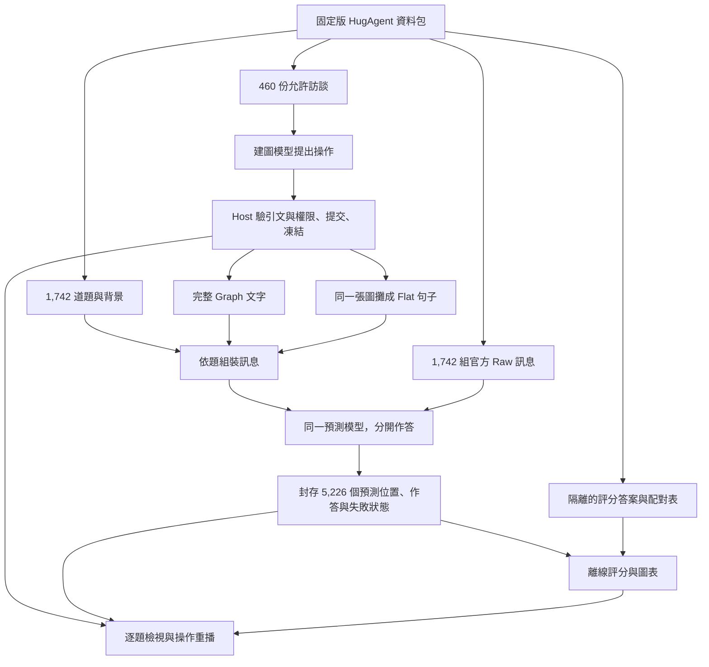

# LLMe 第一輪實驗實作計畫

2026-11-23 · 研究者審核稿 · 域內 HugAgent 真人資料

**把同一個人的同一份訪談交給同一個預測模型，先整理成有原話可查的關係圖，會讓它更準確地預測這個人的回答嗎？** 這是「LLM 能理解我到什麼程度」的第一個可觀察結果。模型可能靠人口背景、共同用詞或常見答案得分。要進一步歸因到某人獨特的判斷，需要另做個人線索對照。

| 要審什麼 | 入口 |
|---|---|
| 本輪要做哪些工作、如何驗收、何時才花錢 | 本頁 |
| LLM 看到什麼、能改什麼、如何查回每一個操作 | [模型與資料接口](experiment-interfaces.md) |
| 跑完可以交出哪些表、圖、數字，結果能支持哪些結論 | [評分與分析計畫](analysis-plan.md) |
| 這週怎麼跟老師講，有哪些決定值得討論 | [八分鐘會議提綱](meeting-experiment-plan.md) |
| 在哪裡看到「樹裡有樹、節點裡有圖」 | [可操作的樹](../tree-review/index.html) · [設計與證據](../graph-tree-design.md) |

## 現況與本輪範圍

資料已就緒，樹的大架構已有共同方向。現有 HTML 可審設計案例。已有書面的模型接口草案；正式 schema、模型設定、預算與計分報表仍待凍結。本文件描述核准後的工作。資料、圖示和免模型基準可供本週報告，三種表示的真人模型成績待測。

| 固定的設計 | 此輪要回答的事 |
|---|---|
| 54 人、英文官方 test，醫療、公共監控、都市分區全留。每個方法都預測相同的 1,742 題 | T1 356 題猜受訪者認為的因果方向。T2 1,386 題猜本人問卷分數，包括立場、感受及理由影響力 |
| 以同人、同域、整份有序 QA 辨識可重用證據，319 份 T1 加 162 份 T2，扣掉兩者共用的 21 份，得到 460 份 | 356 道 T1 有 271 道的遮蔽 QA 在同人同域其他 T2 訪談逐字出現。本題建圖前先鎖證據 |
| 大情境可按角色或議題展開，裡面有局部條件樹，每個有依據的節點可看其主張與取捨圖 | 第一輪 Graph 把有根據的條件與例外編入完整表示。保留這些語義，才能在失誤時查「漏抽了，還是條件用錯了」 |
| 三組共用相同的英文 system、人口背景、題幹、選項／理由／量尺及輸出規則 | 第一輪只改訪談區。預測器每題使用新對話，一次看到整份表示，交一個答案。按題走樹、檢索或追問都會改變讀取策略，另設實驗 |

資料來自指定 fork 的版本 `2bbd18e76db4be1de3b5bce3b5e239898a6a2750`。現有準備程式逐題核對官方 Raw prompt，保存 scorer 與六個 JSONL 的指紋。[資料包與重建方式](prepared-data.md) · [固定版 HugAgent](https://github.com/egger-meow/HugAgent/tree/2bbd18e76db4be1de3b5bce3b5e239898a6a2750/Benchmark)

## 三組各排除什麼解釋

| 組別 | 預測器讀到的訪談區 | 配對比較回答的問題 |
|---|---|---|
| Raw | 該題允許的每段原文問答，沿用官方模板 | 基準。模型直接讀本人談話，能猜多準？ |
| Graph | 建圖器讀同一份 QA，抽出可追查的主張。程式將共享概念、關係兩端、條件、例外和引文編成英文文字 | **Graph 對 Raw** 是主要比較。多一次模型抽取，加上圖的表示，整套做法值不值得？ |
| Flat | 從同一張已凍結的圖，用固定模板將同一批主張、關係、條件與引文寫成英文句子 | **Graph 對 Flat** 固定抽出的內容，檢查顯式連線的呈現能否再增加預測力。**Flat 對 Raw** 補充回答整理成句子後的淨效果 |

不能從三組拆出「只多想一次」的純效果。若 Graph、Flat 都優於 Raw、彼此差距又不明，下輪可加「同一建圖模型、相同 QA、相近處理預算，自由寫文字摘要」；若要宣稱「更懂這一個人」，可加只給背景／題目，以及替換同域他人訪談的配對對照。前者量人口背景與題幹已能解釋多少，後者量換人損失多少。後者須預先匹配可見條件、檢查沒有帶回目標答案、固定配對 seed。這些對照各回答不同疑問，分開估價與立項。[HugAgent 的個人脈絡與跨人分析](https://arxiv.org/html/2510.15144v3#S6)

Graph 與 Flat 的字數、重複概念的次數、證據在文字中的位置仍會隨寫法改變。因此 Graph−Flat 能估計**這款英文圖編碼**的效果。若兩者長度差很大，可以另做同預算敏感度實驗：先用與題目無關的固定順序，選取兩種渲染都放得下的同一批完整主張，再各自渲染，記下被移除的內容與字數。第一輪主結果保留完整輸入。

## 從資料到一張結果表

例如 P07 的公共監控 T1-0009 用 19 段訪談。Raw 直接讀這 19 段；Graph、Flat 共用只看這 19 段建出的快照。監控 T2-0015 是另一張卷，給 20 段，請模型預測影像只存 48 小時時他的支持度。就算那份訪談已經建好圖，T1 也只能用 19 段的版本。對照的最小單位是一道題，建圖快取的最小單位是一份可見訪談，估計不確定性的單位是一個人。[P07 資料對照](round-one.md)

## 未來程式落點與責任

建議沿用現有 Python 與離線資料包。設定與結果使用可讀的 JSON／JSONL、CSV，工作進度與唯一鍵用本機 SQLite；離線報告由同一批表產生。這個規模可在單機分批完成。下列路徑是擬建位置。

| 位置 | 負責 | 交付邊界 |
|---|---|---|
| 現有 `tools/hugagent/prepare.py`，擬增 `llme/adapters/hugagent.py` | 驗證既有檔並提供 History、Question、獨立評分入口 | 三個執行階段各得所需的最少欄位。builder／predictor 程式拿不到評分資料入口或讀檔工具 |
| `llme/graph/` | 證據定位、條件與主張、操作驗證、版本、Graph／Flat 輸出 | 同一份已提交操作可重建同 hash。兩種英文輸出可核對到同一批內容 |
| `llme/providers/` | 本機或 API 模型的統一呼叫、能力與計量 | 實際請求、模型修訂、回覆、用量與失敗原因可回查。憑證由環境提供 |
| `llme/run.py`、`configs/hugagent-round1.json` | 展開工作、鎖版本、續跑、硬預算與封存 | 每個 scope 的建圖與每題每組的作答各自唯一。中斷後由狀態續跑 |
| `llme/evaluation/`、`llme/report/` | 呼叫 pinned scorer、配對分析、製圖、研究者檢視 | 每個數字附分母、run ID 和來源表，可鑽到 item、模型實際輸入與圖 revision |
| `ref/experiments/<run_id>/` | 保存本機 manifest、事件、快照、請求、回覆、表與圖 | 承接既有 Git 忽略的 `ref/`。研究用原文、圖和引文按資料使用條件保存；公開範例以自造資料展示 |

未來 CLI 建議以 `python -m llme.run` 提供 `preflight`、`build`、`render`、`predict`、`score`、`report`、`replay`。每階段接受相同 run ID，讀前一階段已驗證的產物。現在可執行的資料驗收為 `python -X utf8 tools/hugagent/prepare.py --check`。

執行環境建議分成兩種設定。**離線驗收**使用鎖版的 Python 虛擬環境、既有版本資料、合成回覆及原版 scorer，從乾淨 checkout 配合核對過的資料包即可一路跑出測試報告。**正式推論**沿用同一程式與依賴鎖，只換經核定的 provider 設定與 run manifest。原始回覆以唯讀檔案保存，SQLite 對已保存的產物記位置與 hash；工作佇列與輸出報表可以重建。合成與真人使用不同的 run ID、輸出目錄和報告標題。

## 實作順序與驗收

| 階段 | 要完成的工作 | 通過條件 |
|---|---|---|
| 1．資料與 run 骨架 | Adapter、不可變設定、工作清單、答案隔離、模擬模型和獨立 scorer | 核對 54／1,742／460 與檔案 hash；Raw 1,742 題逐字一致；只靠已存回覆就可重算固定 A／1 與五種子隨機兩列基準 |
| 2．建圖與渲染 | 用自造訪談走完整條路，含談論別人、推論、矛盾、條件未知、合法空圖、不同 scope 的相同 `e001` | 錯引文／越權被拒，同一提議重送只提交一次。事件重播重得原 hash。兩種渲染語義清單逐項相等，人工交叉讀英文明確看得出「誰對什麼如此判斷」 |
| 3．預測、恢復與報告骨架 | 建立三組相同條件、parser、預算計量、環境記錄、輸出 CSV／HTML；用合成回覆跑到圖表 | 模擬逾時、中斷、重複回應和建圖失敗，各自有可解釋的終態；無遺漏或重複計分。嚴格格式與官方 parser 並列；圖上的資料點可還原到對應的逐題紀錄 |
| 4．正式設定凍結 | 以合成材料調 prompt、預演最長輸入與最壞輸出、測 provider 限額，登記已看過的真人例題。鎖 endpoint、模型 revision、模板、結構版本、分析規格、費用上限 | 在預測前保存唯讀設定與 hash。若真人只用於相容性預檢，保存 item 清單、遮住 gold、記錄是否進入正式結果。計費與上下文容量未核定前僅進行離線驗收 |
| 5．正式建圖與作答 | 每份建圖到凍結或明確失敗。全量預先渲染檢查容量後，三組交錯排程並封存結果 | 核對 460 個建圖終態、3 × 1,742 個逐題終態。記錄失敗影響的 scope 和題數。預算中止則標部分完成，公布已執行量，可續跑；不把未執行的工作充當正式結果 |
| 6．離線評分與交付 | 跑官方表、配對差、切片、Rank、成本與盲審，產出逐題檢視器及會議版圖表 | 移除模型金鑰後，從封存 run 仍可重建快照、結果表與圖表資料。抽查一題能由圖表回到 prompt、答案、引文與操作。報告交代哪類題改善、哪類退步及未解原因 |

**切換到下一個資料集時。** 保留證據與可見範圍、主張與條件、操作、渲染、模型呼叫、工作紀錄及成對分析。新 adapter 宣告自己的 evidence/source、題目與作答型態、可配對的人與情境、評分規則及是否有時間／本人更正／直接選擇。若只提供單次訪談，仍可看有證據的子圖，時間更新分析標成資料不支援。HugAgent 的三個域、A/B、1–5／1–10、問卷題號及 ATI 都屬 adapter 層。用一個自造的非問卷案例走通通用層；能外推到哪些真人資料集，要靠第二份資料驗證。

## 什麼叫可以重現

1. **同一份封存結果可重算。** Run manifest 保存資料／scorer hash、code commit 與乾淨狀態、依賴鎖與 Python 版本、各模板與操作 schema、渲染順序、設定、seed、排程與實際模型識別。若是本機模型，再記權重與 tokenizer 修訂、精度、推論引擎與硬體。報告另記分析版本與抽樣 seed。
2. **同一張圖可回放。** 將已提交操作在空狀態重播，核對每個凍結版本與最終 hash。保存精確的送出訊息、原始模型回答及官方解析值。原始回覆不能由重新呼叫取代。
3. **另叫一次模型是另一個 run。** 相同設定不能保證託管模型逐字一樣。保存服務回傳的模型 ID／指紋、時間與 finish reason，可用時設 seed。固定圖重跑預測可量作答變異；重建圖再預測才含抽取變異。第一輪單次結果的受訪者區間不涵蓋兩種模型變異。若 provider 無法鎖版本，記錄此限，漂移時另開 run。
4. **帳目與預算可核對。** 預算用真實 tokenizer 或 provider 計量，含 system、工具回覆、重試、輸出與預留。各組分報 tokens、費用、延遲；本機記 GPU 時間與硬體。核定額、單價來源／日期、最壞剩餘預留與已用額一併入 manifest。超額前暫停。冷啟動與同圖多題的費用分算，公式見分析稿。

正式資料全是 test。開發可讀合成案例與已公開檢查的例題來對格式，記下已接觸案例。看到真人得分才改的 prompt、圖規則或分組另開探索 run。若後來要主張經調參的方法能推廣到新人，須另留人層級未碰過的評估資料或新收資料。真人內容的出站方式隨選定的本機／託管端點記錄並核定。[HugAgent 資料使用條件](../../ref/HugAgent/prepared/LICENSE)

## 審核時值得留下的三個答案

| 決定 | 本稿建議 | 選擇會改變什麼 |
|---|---|---|
| 哪些推論能進模型讀的圖？ | 已同意的有據、明標、可糾正推論保留。兩段話各自有依據、但「子規則取代父規則」只靠模型猜時，保留兩條主張，候選覆寫只供稽核 | 定義 Graph／Flat 實際擁有的語義，影響過度解讀與漏掉隱性例外之間的取捨 |
| 怎麼宣告第一輪學到了什麼？ | Graph−Raw 為主要比較，T1 和 T2 各自報效果量及區間。Graph−Flat 解釋呈現方式，Tree 路由靠後續對照 | 若要主張「更便宜且同樣準」，另定可接受的誤差範圍與成本口徑，不能看到結果後才畫線 |
| 用哪個模型、願意為哪種可重現性付費？ | 首輪建圖與預測優先同一個有版本識別、容得下完整輸入的模型，角色工作階段隔離。先核定端點、資料可否送出、單次預算及重跑額度 | 回答「這個固定模型」的問題。用另一模型做 builder 或增加模型種子時，另記實驗版本與費用 |

**後續分岔。** 若抽取時遺失主體或程度，先修建圖並用新資料再驗；若應用條件時常犯錯，且盲審找得到父規則與例外，再用相同凍結規則測平面規則與 Tree。跨域另沿用醫療 → 監控、監控 → 都市分區、都市分區 → 醫療三方向，固定同人、目標題、背景與來源域唯一 T2 訪談，另報相對域內的掉分。此時來源選法、背景含哪些跨域線索都要標明。[原論文跨域設計，第 3 表](https://arxiv.org/html/2510.15144v3#S5) · [本研究配對與限制](round-one.md)
